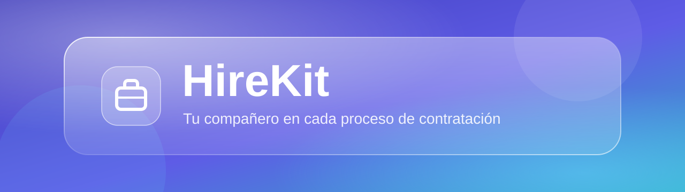

<p align="center">
  
</p>

<p align="center">
  
  
  
  
  
  
  
</p>

# HireKit

HireKit acompaña a las personas durante un proceso de contratación: organiza
cada proceso, sus etapas y sus próximos pasos en una sola app para iPhone, iPad
y Mac, con una interfaz en español construida por completo con Liquid Glass.

Hoy la app incluye la bienvenida, el acceso (inicio de sesión y registro con
validación local), el inicio con pestañas y los ajustes de apariencia. El
detalle de lo que existe y de lo planeado está en
[documentation/app.md](documentation/app.md).

## Requisitos

| Herramienta | Versión |
| --- | --- |
| Xcode | 27.2 o posterior |
| Swift | 6.4 (modo de lenguaje Swift 6) |
| App | iOS, iPadOS y macOS 27 |
| Paquetes | iOS y macOS 26 |

## Primeros pasos

```bash
git clone <url-del-repositorio>
cd HireKit
open HireKitWorkspace.xcworkspace
```

Elige el esquema `HireKit` y ejecuta en un simulador de iPhone o en "My Mac".
No hace falta instalar nada más: el proyecto no tiene dependencias externas.

## Estructura

```
HireKit/                 App: punto de entrada y raíz de composición (DI)
Packages/
├── HKCore/              Contenedor de inyección de dependencias
├── HKDomain/            Entidades, repositorios (contratos) y casos de uso
├── HKData/              Fuentes de datos e implementación de repositorios
├── HKDesignSystem/      Tokens, tema y componentes Liquid Glass
└── HKPresentation/      Vistas, ViewModels, coordinadores y routers
documentation/           Cerebro del proyecto: arquitectura, routing, negocio…
```

Cada paquete tiene su propio README:
[HKCore](Packages/HKCore/README.md),
[HKDomain](Packages/HKDomain/README.md),
[HKData](Packages/HKData/README.md),
[HKDesignSystem](Packages/HKDesignSystem/README.md) y
[HKPresentation](Packages/HKPresentation/README.md).

## Documentación

| Documento | Contenido |
| --- | --- |
| [App](documentation/app.md) | Producto, plataformas, flujos y estado actual |
| [Negocio](documentation/business.md) | Reglas de negocio y modelo de dominio |
| [Arquitectura](documentation/architecture.md) | Capas, paquetes e inyección de dependencias |
| [Routing](documentation/routing.md) | Flujos, routers, coordinadores y deep links |
| [Design System](documentation/design-system.md) | Principios Liquid Glass y catálogo de componentes |

## Pruebas

```bash
cd Packages/HKPresentation
xcodebuild test -scheme HKPresentation -destination 'platform=iOS Simulator,name=iPhone 17'

cd ../..
xcodebuild test -project HireKit.xcodeproj -scheme HireKit -only-testing:HireKitTests \
    -destination 'platform=iOS Simulator,name=iPhone 17'
```

Todas las pruebas usan Swift Testing. Los comandos de cada paquete están en su
README.

## Dependencias

HireKit solo usa frameworks de Apple. Cualquier dependencia nueva se registra
aquí, en el README del paquete que la usa y en el [CHANGELOG](CHANGELOG.md).

| Dependencia | Tipo | Versión | Usada por | Motivo |
| --- | --- | --- | --- | --- |
| SwiftUI | Framework de Apple | SDK 27 | HKDesignSystem, HKPresentation, app | Interfaz y Liquid Glass |
| Observation | Framework de Apple | SDK 27 | HKPresentation, HKDesignSystem | ViewModels `@Observable` |
| Foundation | Framework de Apple | SDK 27 | Todos | Tipos base y `UserDefaults` |
| Swift Testing | Framework de Apple | Swift 6.4 | Tests de todos los paquetes | Pruebas unitarias |
| XCTest | Framework de Apple | SDK 27 | HireKitUITests | Pruebas de interfaz |

Dependencias de terceros: **ninguna**.

## Cambios

El historial está en [CHANGELOG.md](CHANGELOG.md).
